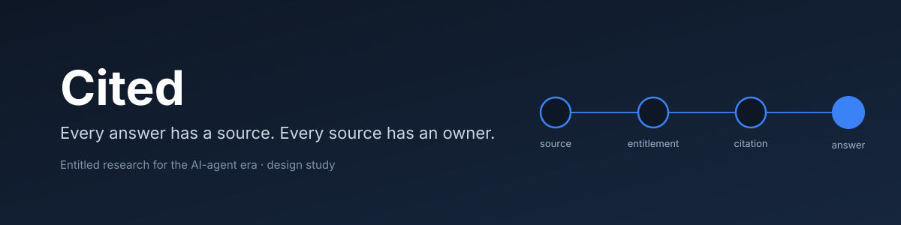
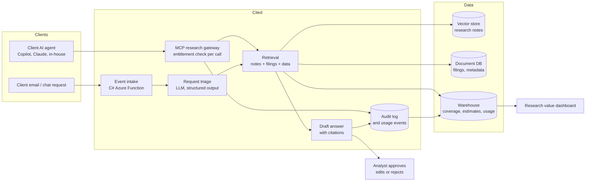
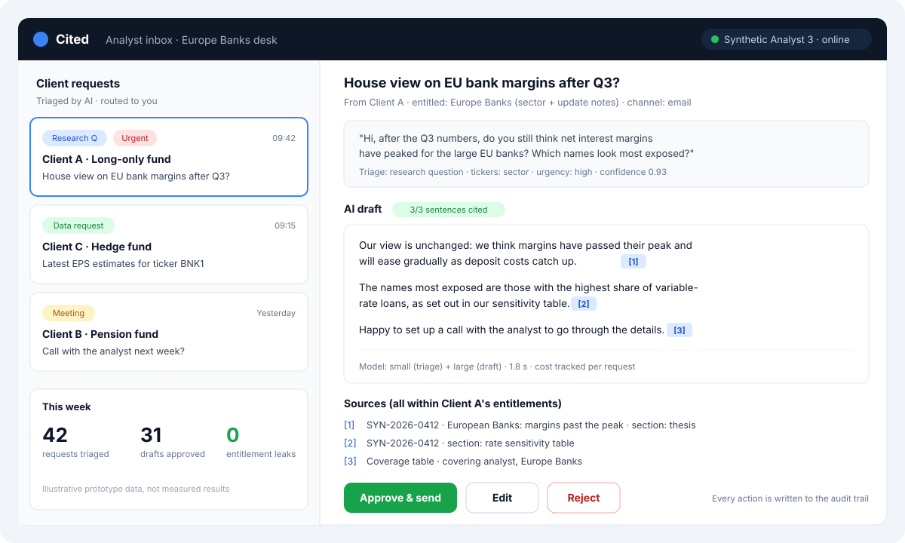
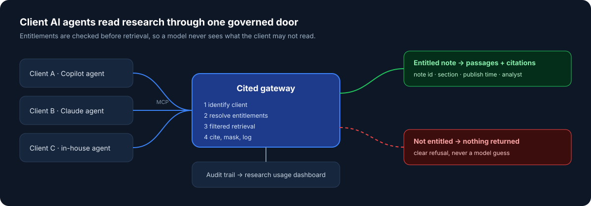

### Entitled research for the AI-agent era: every answer has a source, every source has an owner.

[The problem](#-the-problem) ·
[The solution](#-the-solution) ·
[Prototype](#-prototype) ·
[Why this design](#-why-this-design) ·
[Capabilities](#-technical-capabilities) ·
[Documents](#-documents)

> [!NOTE]
> **Status (October 2026): research and technical design are published, with a 4-week build plan.** No production code yet.
> The research desk, notes and clients in the design are synthetic. Results will be published here only once measured.

**Cited** is a design study for an equity-research desk that wants AI to work *for* it, not around it.
It gives client AI agents and internal analysts governed access to research through the
**Model Context Protocol (MCP)**: every call is checked against the client's entitlements, every answer
cites the note it came from, and every read is logged so the desk knows what its research is actually worth.

---

## 🎯 The problem

Sell-side research is expensive to produce and easy to leak. Three shifts are hitting research desks at the same time:

1. **Clients now read research through AI agents.** Data and research providers are opening governed AI access:
   FactSet put a production MCP server in front of its datasets in December 2025, and in June 2026 Aiera launched a
   platform, backed by several large banks, that lets clients query the research they are entitled to through API and MCP
   connectors, with entitlement checks on every pull and usage sent back to the provider. A desk without its own governed
   channel ends up with its PDFs pasted into tools it cannot see.
2. **Research value must be proven again.** In the EU, the Listing Act lets firms pay for research and execution together
   again from June 2026, but it requires an annual assessment of the quality, usability and value of the research they consume.
   Usage data per client, per note and per analyst becomes a commercial asset.
3. **Banks buy the assistant and build the integration.** Large banks are standardising on market AI assistants rather than
   in-house chatbots (Société Générale replaced its internal SoGPT with Microsoft Copilot in early 2026 and signed a strategic
   agreement with Anthropic in September 2026). The assistant is no longer the differentiator. Secure connections between
   the assistant and the bank's own data and workflows are, and that is integration work.

Analysts also lose time on repetitive work: client questions arrive by email and chat, and a large share of research pages are
routine earnings previews and reviews. Société Générale already proved the value of request triage with classic NLP
(its SG Markets "My Cases" tool reported a 30% shorter response time on client requests).

## 🧭 The solution

| Module | What it does |
|---|---|
| **MCP research gateway** | Exposes research as MCP tools (`search_research`, `get_note`, `get_coverage`, `get_estimates`). Checks the caller's entitlement on every call, returns only what they are allowed to see, always with citations |
| **Event intake** | A C#/.NET Azure Function receives new client requests and new notes as events (queue-triggered), validates them and hands them to the Python services |
| **Request triage** | Classifies each client request (research question, data request, meeting, other), extracts tickers and urgency, routes it to the covering analyst. Structured JSON output, validated |
| **Retrieval** | One retrieval layer over three kinds of data: unstructured notes (vector search), semi-structured filings and metadata (document DB), structured coverage and estimates (warehouse) |
| **Draft answer** | Drafts a reply in the house style. Every sentence must cite a note or filing; unsupported sentences are dropped. Nothing is sent without analyst approval |
| **Audit and usage** | Every tool call, retrieval and draft is logged with who, what, when and which entitlement allowed it. Usage feeds a research value dashboard (reads per client, per note, per analyst) |

## 🖼️ Prototype

**Analyst inbox.** Client requests arrive triaged; the AI drafts a reply where every sentence cites a note the client
is entitled to; the analyst approves, edits or rejects.

**Client agent access.** Client AI agents reach research through one governed MCP door.

Prototype screens with illustrative, synthetic data. Not measured results.

## 🛡️ Why this design

- **Governed, not open.** Entitlements are enforced in the gateway, not in the prompt. The model never sees a document the caller is not allowed to read.
- **Human in the loop where it matters.** Agents may *read* research; only analysts *send* it.
- **Assistant-agnostic.** MCP means the same gateway serves Copilot, Claude or a client's in-house agent. The bank can switch assistants without rebuilding integrations.
- **Built on the bank's stack.** Azure for hosting and models (Azure AI Foundry), .NET where it meets existing enterprise systems, Python for AI services.
- **Measurable.** Retrieval quality, citation accuracy, triage accuracy, latency and cost per request are tracked from day one.

## 🧰 Technical capabilities

What this project demonstrates, and what I can deliver on a team:

| Area | In Cited | Tools |
|---|---|---|
| **AI application development** | Triage, retrieval-augmented drafting, citation checking, refusal when no source | Python, LLM APIs (Azure AI Foundry, open models), structured outputs |
| **Integration** | REST APIs, MCP server, event-driven intake, orchestrated multi-step workflow | FastAPI, MCP Python SDK, Azure Storage Queues / Service Bus, C#/.NET Azure Functions |
| **Data** | Structured, semi-structured and unstructured sources behind one retrieval layer | PostgreSQL + pgvector, MongoDB-compatible document store, Databricks (or DuckDB locally) |
| **Cloud** | Target deployment on Azure with managed identity and secrets in Key Vault | Azure Container Apps, Azure Functions, Key Vault, Application Insights |
| **DevOps** | Tests, lint and build for Python and .NET on every push; staged deployment | Git, GitHub Actions, Docker, pytest, xUnit |
| **Security and compliance** | Per-call entitlements, PII masking, prompt-injection defence, tamper-evident audit trail | Policy layer, hashing, structured logs |
| **Observability and cost** | Traces per request, token and cost tracking, model routing (small model for triage, larger for drafting) | OpenTelemetry, Application Insights |

## 📚 Documents

1. [Context and research findings](docs/01-context.md): why a desk like Bernstein's needs this now, with sources
2. [Architecture](docs/02-architecture.md): components, data flows, Azure target deployment
3. [MCP tool specification](docs/03-mcp-tools.md): tools, inputs, outputs, entitlement rules
4. [Security and compliance](docs/04-security.md): entitlements, audit, data protection, AI-specific risks
5. [Evaluation, observability and cost](docs/05-evaluation.md): what is measured and how
6. [Build plan](docs/06-build-plan.md): 4-week plan and definition of done

## ⚠️ Limitations

- Real research notes and client entitlements are proprietary, so the build uses **synthetic notes and clients** plus public SEC filings.
- This is not investment advice and does not model research pricing.
- Regulatory points are summarised for design purposes and are not legal advice.

## 👤 Author

**Anass El Alaoui**, AI developer (Python, LLM/RAG, workflow automation).
[LinkedIn](https://www.linkedin.com/in/anass-el-alaoui-b05316177/)
