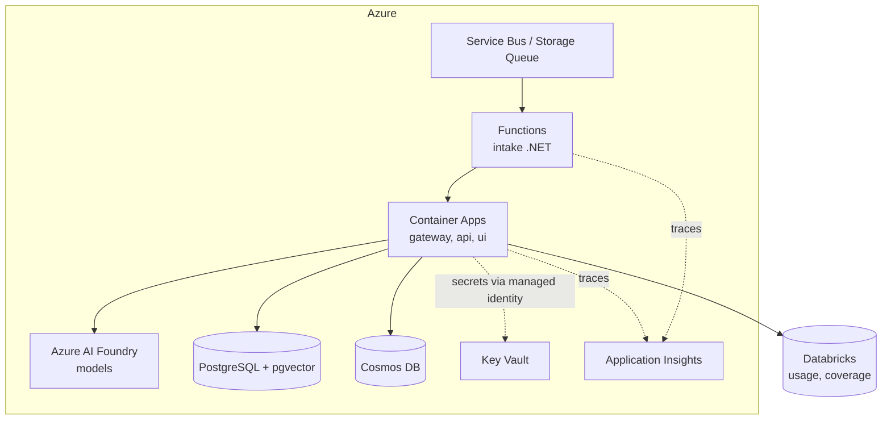

# 2. Architecture

## 2.1 Components

| Component | Language | Responsibility |
|---|---|---|
| `gateway` | Python (MCP SDK) | MCP server exposing research tools; authenticates the caller, resolves entitlements, calls `retrieval`, returns cited results |
| `api` | Python (FastAPI) | REST API for the analyst UI and internal services: requests, drafts, approvals, usage |
| `intake` | C# (.NET 8, Azure Functions isolated worker) | Queue-triggered: receives new client requests and new notes, validates schema, de-duplicates, calls `api` |
| `triage` | Python | LLM classification of requests into a fixed taxonomy, with tickers, urgency and routing; Pydantic-validated JSON |
| `retrieval` | Python | Hybrid search (vector + keyword) over notes; lookups in document DB and warehouse; applies the entitlement filter **before** ranking |
| `drafting` | Python | Drafts replies from retrieved passages; sentence-level citation check; drops unsupported sentences |
| `policy` | Python | Entitlement rules, PII masking, prompt-injection screening of retrieved text |
| `audit` | Python | Append-only event log with hash chaining; exports usage events to the warehouse |
| `ui` | Next.js | Analyst inbox: triaged requests, drafts with citations, approve / edit / reject; desk usage dashboard |

## 2.2 Data

| Kind | Example | Store (local → Azure target) |
|---|---|---|
| Unstructured | Research notes (synthetic), filing text | PostgreSQL + pgvector → Azure Database for PostgreSQL |
| Semi-structured | Note metadata, SEC filing JSON, client requests | MongoDB-compatible store → Azure Cosmos DB (MongoDB API) |
| Structured | Coverage list, estimates, entitlements, usage events | DuckDB → Databricks (Delta tables) |

Notes are chunked by section (thesis, estimates, risks, valuation) so citations point to a meaningful part of a note,
not to an arbitrary character window.

## 2.3 Flow A: a client agent asks a question (MCP)

1. The client's agent calls `search_research(query, tickers)` on the gateway with its client credential.
2. `policy` resolves the client's entitlements (e.g., sectors, regions, note types, embargo times).
3. `retrieval` searches **only** the entitled subset, ranks, and returns passages with note id, section and publish time.
4. `policy` screens returned text for instructions aimed at models (treated as data) and masks personal data.
5. `audit` records the call: client, tool, query hash, documents returned, entitlement rule used, latency, tokens.
6. The agent receives passages and citations. It never receives non-entitled content, so it cannot leak it.

## 2.4 Flow B: a client emails an analyst (workflow)

1. The email arrives in a shared mailbox; a connector (Microsoft Graph in the target design) puts a message on the `requests` queue.
2. `intake` (C#) validates and de-duplicates, then calls `api`.
3. `triage` classifies and routes to the covering analyst; low confidence goes to a human queue.
4. `retrieval` + `drafting` prepare a draft with citations, limited to the client's entitlements.
5. The analyst approves, edits or rejects in the UI. Only an approved draft can be sent.
6. Every step is audited; the outcome (approved, edited, rejected) feeds evaluation.

## 2.5 Target deployment on Azure

- Managed identity everywhere; no secrets in code or config.
- Private networking between services in the target design; the gateway is the only public entry point.
- Local development runs the same services with Docker Compose and Azurite (the Azure Storage emulator), so the project
  can be built and tested at zero cost.

## 2.6 Model strategy

- **Triage**: small, cheap model; strict JSON schema; temperature 0.
- **Drafting**: larger model only when a draft is needed.
- **Provider interface**: one `LLMProvider` abstraction with an Azure AI Foundry implementation and an open-model implementation
  for local runs. Swapping models is configuration, not code.
